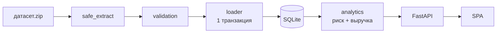

# Aéza Analyzer

Аналитическая система для Aéza: выявляет клиентов и услуги с повышенным риском
оттока, объясняет причины риска и оценивает **выручку под риском** — на реальных
данных организатора хакатона UMIRHack 2026.

---

## Что это и зачем

Провайдер услуг (хостинг, VPS, домены) теряет выручку не тогда, когда клиент
уходит, а тогда, когда услуга перестаёт продлеваться. Задача — увидеть это
заранее и понять, сколько денег под угрозой.

Aéza Analyzer отвечает на три вопроса:

1. **Кто** в зоне риска — клиенты и услуги, отсортированные по риску оттока.
2. **Почему** — каждый балл риска разложен на факторы с человекочитаемыми
   причинами (истекает скоро, автопродление выключено, не хватает баланса,
   были неудачные продления, проблемный статус).
3. **Сколько** — выручка под риском в евро по будущим продлениям в заданном
   горизонте.

Кому полезно:

| Роль | Что получает |
|---|---|
| Аккаунт-менеджер | список клиентов под угрозой и причины — с кем работать |
| Финансы | денежная экспозиция по горизонту, а не абстрактный «риск» |
| Продукт | какие статусы и условия коррелируют с оттоком |
| Аналитик | прозрачная формула, воспроизводимые расчёты, профиль данных |

---

## Возможности

- **Dashboard**: счётчики, распределение по уровням риска и статусам услуг,
  выручка под риском и сумма доступных продлений.
- **Клиенты**: поиск по email, фильтр по уровню, сортировка по риску / выручке
  / балансу / id, в обе стороны.
- **Карточка клиента**: услуги, факторы риска с весами и деталями, причины,
  балансы, выручка под риском.
- **Услуги**: все услуги со скорингом и фильтром по статусу.
- **Настройка модели**: изменение весов с немедленным пересчётом, сброс.
- **Данные**: метаданные источника (sha256, момент снимка) и воспроизводимый
  профиль данных; повторный импорт из интерфейса.
- **Импорт**: безопасная распаковка, валидация, атомарная идемпотентная загрузка.
- **CLI**: `import`, `audit`, `serve`.

## Статус реализации

| Компонент | Статус |
|---|---|
| Импорт и валидация датасета | ✅ работает |
| Хранилище (SQLite) | ✅ работает |
| Скоринг риска и объяснения | ✅ работает |
| Выручка под риском | ✅ работает |
| REST API | ✅ работает |
| Веб-интерфейс | ✅ работает |
| Тесты (52) | ✅ проходят |
| Обученная ML-модель | ❌ не реализована (и не заявляется) |
| Аутентификация | ❌ отсутствует — см. [SECURITY](docs/SECURITY.md) |
| PostgreSQL как основное хранилище | ❌ не используется (только SQLite) |
| Развёртывание на Render | ⚠️ не выполнялось, только оценка совместимости |

---

## Быстрый старт

```bash
git clone https://github.com/Pixelminds-hub/aeza-analizer.git
cd aeza-analizer
chmod +x run.sh
./run.sh
```

Откройте **<http://127.0.0.1:8000/>**.

`run.sh` сам создаёт виртуальное окружение, ставит зависимости, импортирует
`датасет.zip` при первом запуске и поднимает сервер.

```bash
./run.sh --help           # все опции
./run.sh --port 9000      # другой порт
./run.sh --host 0.0.0.0   # доступ извне
./run.sh --no-import      # не импортировать (использовать текущую базу)
./run.sh --reimport       # принудительно переимпортировать датасет
```

**Повторный запуск безопасен:** существующая база не пересоздаётся и не
затирается. Обновить данные — `./run.sh --reimport` или `POST /api/import`.

## Ручной запуск (для разработки)

```bash
python -m venv .venv
.venv/bin/pip install -r requirements.txt

python -m aeza_analyzer.cli import        # загрузить датасет
python -m aeza_analyzer.cli audit         # профиль данных (JSON)
python -m aeza_analyzer.cli serve --port 8000
```

## Запуск тестов

```bash
python -m pytest tests/ -q     # 69 тестов (52 аналитика + 17 auth)
```

## CLI

| Команда | Назначение |
|---|---|
| `import [--source PATH] [--lenient]` | импорт датасета |
| `audit` | воспроизводимый профиль хранилища (JSON) |
| `serve [--host] [--port] [--reload]` | запуск приложения |

`--lenient` сохраняет валидные строки и отчёт об отклонённых; по умолчанию
импорт прерывается при первой ошибке.

---

## Архитектура



Подробно: [`docs/ARCHITECTURE.md`](docs/ARCHITECTURE.md).

| Слой | Модули |
|---|---|
| Импорт | `importer/archive.py`, `validation.py`, `loader.py` |
| Хранение | `models.py`, `db.py`, `money.py` |
| Аналитика | `analytics/risk.py`, `analytics/service.py` |
| API / UI | `api/app.py`, `static/` |

## Требования

- Python **3.10+**
- ~50 МБ на зависимости
- внешние сервисы не нужны

## Конфигурация

| Переменная | По умолчанию | Назначение |
|---|---|---|
| `AEZA_DATA_DIR` | `<root>/data` | каталог хранилища |
| `AEZA_SOURCE_ZIP` | `<root>/датасет.zip` | исходный архив |
| `AEZA_DATABASE_URL` | SQLite в `AEZA_DATA_DIR` | переопределение БД |
| `AEZA_HOST` / `AEZA_PORT` | `127.0.0.1` / `8000` | адрес сервера |
| `AEZA_VENV_DIR` | `<root>/.venv` | venv для `run.sh` |

Секретов приложение не требует.

## Данные

Источник — `датасет.zip` организатора: **10 аккаунтов, 30 услуг, 100
транзакций**. Подробности и профиль: [`docs/IMPORT_AND_DATA_AUDIT.md`](docs/IMPORT_AND_DATA_AUDIT.md),
словарь полей — [`docs/DATA_DICTIONARY.md`](docs/DATA_DICTIONARY.md).

## Методология риска

```
risk_score = 100 × Σ(wᵢ·fᵢ) / Σwᵢ
```

| Фактор | Вес |
|---|---:|
| `expiry_proximity` | 1.0 |
| `autoprolong_off` | 0.8 |
| `insufficient_balance` | 1.0 |
| `failed_renewals` | 0.6 |
| `status_risk` | 0.9 |

Уровни: **низкий 0–34, средний 35–64, высокий 65–100**.
Подробно: [`docs/ANALYTICS_METHODOLOGY.md`](docs/ANALYTICS_METHODOLOGY.md).

Это **объяснимая взвешенная модель, не обученная ML**: 10 аккаунтов и 30 услуг
недостаточно, чтобы обучить и провалидировать статистическую модель.

## Методология выручки под риском

```
revenue_at_risk = eligible_renewal_amount × risk_score / 100
```

Учитываются только **будущие** продления внутри горизонта; `deleted`-услуги,
истёкшие продления, баланс и пополнения исключены. Подробно:
[`docs/REVENUE_METHODOLOGY.md`](docs/REVENUE_METHODOLOGY.md).

## Confidence и ограничения модели

`confidence` — доля веса, для которой есть данные. Если по фактору данных нет,
он **исключается** из расчёта, а `confidence` падает. Отсутствие данных никогда
не трактуется как «нулевой риск».

## Денежная модель

Внутри — **целые евроценты** (правило кейса: 100 единиц = €1). Евро
добавляются один раз на границе API как `*_eur`. Двойной конвертации нет.
`transactions.amount` **деньгами не является** и в выручке не участвует.

## Ограничения исходного датасета

- Данные **синтетические** и представляют снимок, а не историю.
- Нет полной истории пополнений (только `order` и `prolong`).
- Балансы не выводятся из транзакций.
- **17 из 30 услуг истекли до момента снимка** — поэтому выручка под риском
  мала (€7.48 при горизонте 30 дней). Это корректно: истёкшие продления не
  являются будущими.

## Устранение неполадок

| Симптом | Решение |
|---|---|
| `Python 3.10+ is required` | установите Python 3.10+ |
| `port ... already in use` | `./run.sh --port 9000` |
| `source archive not found` | положите `датасет.zip` в корень или задайте `AEZA_SOURCE_ZIP` |
| `not a usable database` | удалите `data/aeza.sqlite` и выполните `./run.sh --reimport` |
| Дашборд пуст | данные не импортированы: `./run.sh --reimport` |
| Ошибка при импорте | запустите `python -m aeza_analyzer.cli import` и прочитайте причины отклонённых строк |

## Структура репозитория

```
aeza_analyzer/    риск-аналитика (этот продукт)
  importer/       распаковка, валидация, загрузка
  analytics/      скоринг, выручка, агрегация
  api/            FastAPI-эндпоинты
  static/         SPA
backend/          модуль аутентификации (отдельное приложение)
db/               схема и БД auth-модуля
tests/            69 тестов (52 аналитика + 17 auth)
docs/             документация
run.sh            запуск одной командой
датасет.zip       исходные данные организатора
```

## Документация

| Документ | Содержание |
|---|---|
| [`docs/REQUIREMENTS_TRACEABILITY.md`](docs/REQUIREMENTS_TRACEABILITY.md) | соответствие требованиям |
| [`docs/ARCHITECTURE.md`](docs/ARCHITECTURE.md) | компоненты и потоки данных |
| [`docs/DATA_DICTIONARY.md`](docs/DATA_DICTIONARY.md) | поля, типы, единицы |
| [`docs/SCHEMA_MAPPING.md`](docs/SCHEMA_MAPPING.md) | источник → модель приложения |
| [`docs/ANALYTICS_METHODOLOGY.md`](docs/ANALYTICS_METHODOLOGY.md) | формула риска |
| [`docs/REVENUE_METHODOLOGY.md`](docs/REVENUE_METHODOLOGY.md) | выручка под риском |
| [`docs/IMPORT_AND_DATA_AUDIT.md`](docs/IMPORT_AND_DATA_AUDIT.md) | импорт и профиль данных |
| [`docs/API.md`](docs/API.md) | эндпоинты и схемы |
| [`docs/DEVELOPMENT.md`](docs/DEVELOPMENT.md) | разработка и соглашения |
| [`docs/TESTING.md`](docs/TESTING.md) | тесты и проверки |
| [`docs/DEPLOYMENT.md`](docs/DEPLOYMENT.md) | запуск и развёртывание |
| [`docs/SECURITY.md`](docs/SECURITY.md) | безопасность и ограничения |
| [`AGENTS.md`](AGENTS.md) | заметки для агентов и будущих сессий |

---

## Модуль аутентификации (`backend/`)

Репозиторий содержит **два независимых приложения**, написанных разными
участниками команды. Они не связаны друг с другом на уровне кода и запускаются
раздельно.

| Модуль | Каталог | Назначение | Запуск |
|---|---|---|---|
| **Aéza Analyzer** (этот README) | `aeza_analyzer/` | риск оттока и выручка под риском на датасете организатора | `./run.sh` |
| **Auth module** | `backend/` | аутентификация: сессии, RS256 JWT, вход/выход | `uvicorn backend.main:app` |

Auth-модуль реализует вход по логину/паролю, серверные сессии и подписанные
RS256 токены, хранит пользователей в отдельной БД (`db/auth.sqlite3`,
схема `db/schema.sql`) и покрыт 17 тестами (`tests/test_auth.py`).

> **Замечание по качеству.** Модуль добавлен другим участником и не
> документирован в этом README детально — его устройство описано только в коде
> и тестах. Интеграция двух приложений в один продукт **не выполнялась**:
> `aeza_analyzer` не использует `backend` для аутентификации. Если требуется
> единый продукт с защищённым API, это отдельная задача — см.
> [`docs/SECURITY.md`](docs/SECURITY.md).

Общие зависимости обоих модулей закреплены в `requirements.txt`.

## Лицензия

Проект создан для хакатона UMIRHack 2026 (кейс Aéza). Данные принадлежат
организатору.
