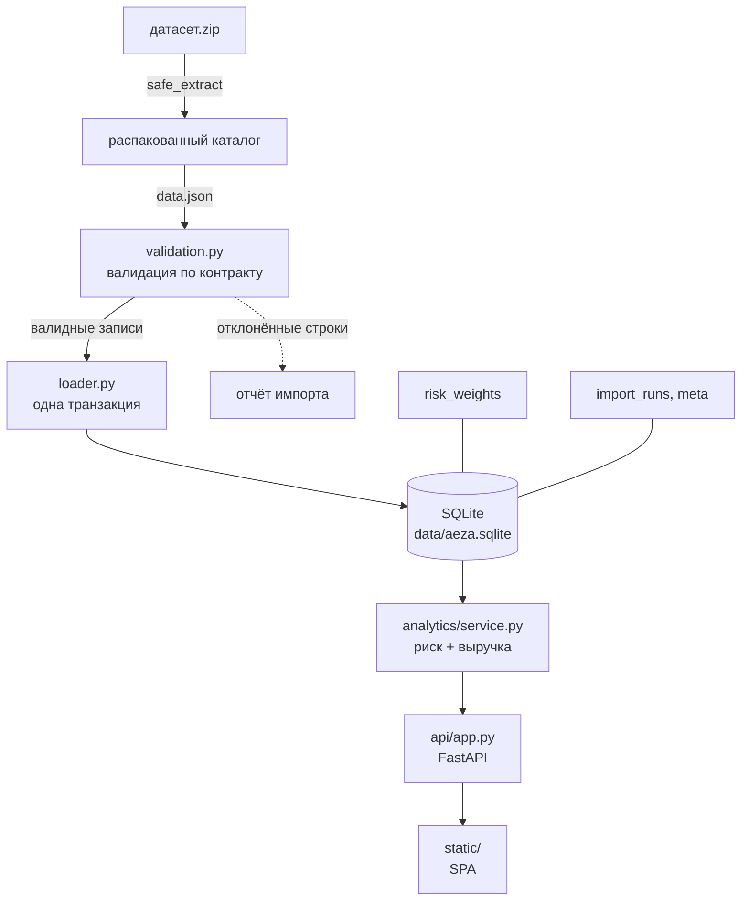
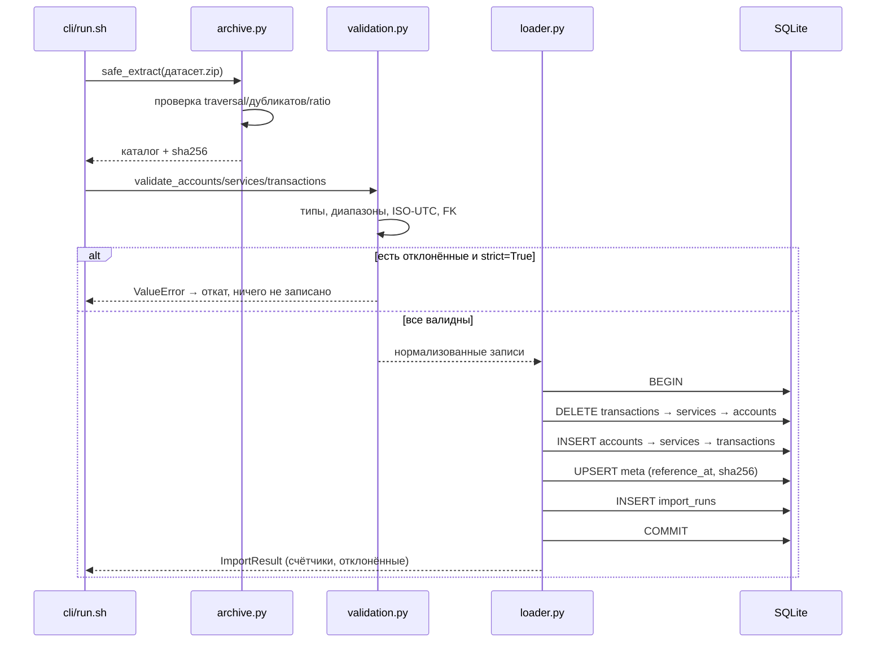
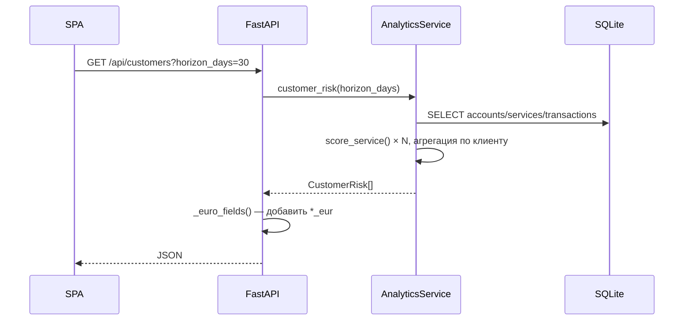

# Архитектура

## Обзор

Aéza Analyzer — монолитное Python-приложение: FastAPI-сервис с встроенным
SQLite-хранилищем и статическим SPA. Внешних сервисов и очередей нет.



## Слои

| Слой | Модули | Ответственность | Зависит от |
|---|---|---|---|
| Конфигурация | `config.py` | пути из env, ленивые свойства | — |
| Деньги | `money.py` | евроценты → евро (100:1) | — |
| Хранение | `models.py`, `db.py` | ORM-модели, engine, проверка хранилища | config, models |
| Импорт | `importer/archive.py`, `validation.py`, `loader.py` | распаковка, валидация, атомарная загрузка | db, models |
| Аналитика | `analytics/risk.py`, `analytics/service.py` | скоринг, агрегация, выручка | models |
| Аудит | `audit.py` | воспроизводимый профиль данных | models |
| API | `api/app.py`, `api/schemas.py` | REST, конвертация в евро | analytics, importer |
| CLI | `cli.py` | `import` / `audit` / `serve` | все слои |
| UI | `static/*` | SPA, работа с API | API |

Слои не пересекаются: аналитика не знает про HTTP, импорт — про аналитику,
API — про формулы.

## Последовательность импорта



## Поток запроса



## Ключевые решения

| Решение | Причина | Альтернатива отклонена |
|---|---|---|
| SQLite как хранилище по умолчанию | нулевая настройка, запуск одной командой | PostgreSQL требует внешнего сервиса |
| Целые евроценты внутри | нет ошибок округления float | Decimal везде — избыточно |
| Евро на границе API | одна точка конвертации | конвертация в моделях → риск двойной |
| `UTCDateTime` TypeDecorator | SQLite теряет tz | сравнение naive/aware ломается |
| Ленивые свойства `Settings` | тесты и env без перезагрузки модулей | dataclass с полями замораживал пути |
| Замена таблиц вместо upsert | простая идемпотентность | upsert усложняет и риск дублей |
| `reference_at` из данных | воспроизводимость | системные часы дают разные ответы |

## Зависимости

```
fastapi          веб-фреймворк
uvicorn          ASGI-сервер
sqlalchemy       ORM
pydantic         схемы запросов
httpx            клиент для тестов (TestClient)
pytest           тесты
```

Внешних сервисов, брокеров и фоновых воркеров нет. Приложение stateless,
кроме файла SQLite.

## Расширение

- **Другое хранилище**: задать `AEZA_DATABASE_URL` (нужен драйвер).
- **Новые факторы риска**: добавить ключ в `DEFAULT_WEIGHTS`, функцию-фактор и
  вес в `score_service`.
- **Новый эндпоинт**: добавить функцию в `api/app.py`, схему в `schemas.py`.
